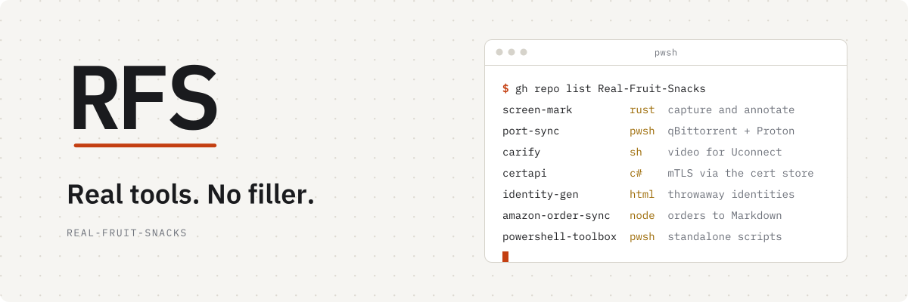

  <picture>
    <source media="(prefers-color-scheme: dark)" srcset="assets/rfs-banner-dark.svg">
    
  </picture>

# .github

Org-wide defaults and the RFS identity. Themes are **Nightshift** (dark, default) and **Dayshift** (light); asset filenames keep plain `-dark` / `-light` suffixes so they stay self-describing. Everything that makes the repos under `Real-Fruit-Snacks` look and read like one org lives here.

| Path | What it is | Who reads it |
|---|---|---|
| [`profile/README.md`](profile/README.md) | The org profile page | GitHub, automatically |
| [`assets/`](assets/) | Header SVGs and the avatar, referenced by every repo README via raw URL | Other repos |
| [`brand/`](brand/) | The full asset set — mark, lockups, social, web icons, design tokens | You, when you need a file |
| [`templates/repo/`](templates/repo/) | README template and per-repo settings checklist | You, when starting or cleaning up a repo |
| [`tools/`](tools/) | `make-social.py` — generates a 1280×640 social-preview card for any repo | You, once per repo |
| [`BRAND.md`](BRAND.md) | The identity guide: color, type, mark, voice, naming | Anyone touching the brand |

## Starting a new repo

1. Copy `templates/repo/README.md`, fill it in, delete the HTML comments.
2. Work through `templates/repo/SETTINGS-CHECKLIST.md`.
3. `python3 tools/make-social.py <repo-name> "<one-line description>"` → upload the PNG as the social preview.

## Changing the brand

Edit `BRAND.md` first, then regenerate assets. Assets are derived; the guide is the source. Because every repo loads its header from `assets/` in this repo, a change here is live everywhere on the next page load — be sure.

## Licenses

Code in `tools/` is MIT. Fonts in `tools/fonts/` are IBM Plex, SIL Open Font License (`OFL.txt`). The RFS mark and name are not licensed for reuse.
