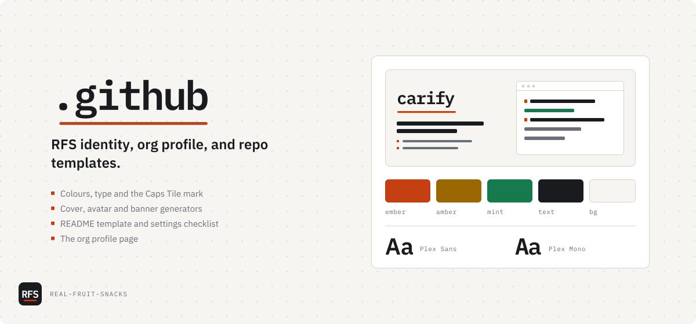

# .github

RFS identity, org profile, and repo templates.

<picture>
  <source media="(prefers-color-scheme: dark)" srcset="docs/assets/cover-dark.svg">
  
</picture>

Org-wide defaults and the RFS identity. Themes are **Nightshift** (dark, default) and **Dayshift** (light); asset filenames keep plain `-dark` / `-light` suffixes so they stay self-describing. Everything that makes the repos under `Real-Fruit-Snacks` look and read like one org lives here.

| Path | What it is | Who reads it |
|---|---|---|
| [`profile/README.md`](profile/README.md) | The org profile page | GitHub, automatically |
| [`assets/`](assets/) | The profile banner and the mark, loaded by raw URL | The org profile |
| [`brand/`](brand/) | The full asset set — mark, lockups, social, web icons, design tokens | You, when you need a file |
| [`templates/repo/`](templates/repo/) | README template and per-repo settings checklist | You, when starting or cleaning up a repo |
| [`tools/`](tools/) | `make-cover.py` renders a repo's README cover and social preview from its `docs/assets/cover.toml`; `make-org-art.py` renders the profile banner, org social preview and X header from `brand/org.toml`; `make-avatar.py` renders the profile picture | You, once per repo and after a description or tool-list change |
| [`BRAND.md`](BRAND.md) | The identity guide: color, type, mark, voice, naming | Anyone touching the brand |

## Starting a new repo

1. Copy `templates/repo/README.md`, fill it in, delete the HTML comments.
2. Work through `templates/repo/SETTINGS-CHECKLIST.md`.
3. Copy `templates/repo/cover.toml` to the repo's `docs/assets/`, fill it in, then `python3 tools/make-cover.py <repo>/docs/assets/cover.toml`. Commit the `cover-*` files; upload `social-dark.png` as the social preview.

## Changing the brand

Edit `BRAND.md` first, then regenerate assets. Assets are derived; the guide is the source. The org profile loads its banner from `assets/` by raw URL, so a change there is live on the next page load. Repo covers are committed in each repo, so they only change when you re-run `make-cover.py` there.

When a tool is added, renamed or archived, update `brand/org.toml` and `profile/README.md`, then run `python3 tools/make-org-art.py`.

## Licenses

Code in `tools/` is MIT. Fonts in `tools/fonts/` are IBM Plex, SIL Open Font License (`OFL.txt`). The RFS mark and name are not licensed for reuse.
