# rfs-brand

RFS brand system, profile art, and repository templates

<picture>
  <source media="(prefers-color-scheme: dark)" srcset="docs/assets/cover-dark.svg">
  
</picture>

```powershell
curl.exe -LO https://github.com/Real-Fruit-Snacks/rfs-brand/releases/latest/download/rfs-brand.zip
```

- **Cyclorama Dawn identity:** Matte `#050507` dark default (`LX 263`) and `#F5F7F9` Alabaster Day light mode (`LX 512`) anchored by Glacial Steel and Maritime Beacon Orange.
- **Drop-in kit (`brand/`):** CSS tokens (`rfs.css`), component kit (`rfs-components.css`), 60 monochrome icons (`rfs-icons.svg`), JSON tokens, marks, and `BRAND-RULES.md`.
- **Deterministic generators (`tools/`):** Python scripts outlining self-hosted variable fonts for zero-dependency SVG covers, marks, icons, avatars, and org art.
- **Repo templates (`templates/repo/`):** Ultra-minimal README starter, `AGENTS.md`, `cover.toml`, `SECURITY.md`, GitHub templates, and repo settings checklist.

## Documentation

- [Living brand manual](https://real-fruit-snacks.github.io/rfs-brand/)
- [Authoritative Brand Guide](BRAND.md)
- [Agent Brand Rules](brand/BRAND-RULES.md)
- [Kit Downloads, Generators & Repo Setup](docs/USAGE.md)
- [Design System Spec](docs/DESIGN.md)

## License

Code in `tools/` is MIT. Fonts in `tools/fonts/` (`Big Shoulders Stencil`, `Albert Sans`, and `Azeret Mono`) are SIL OFL 1.1 (`tools/fonts/OFL.txt`). The RFS mark and name are not licensed for reuse.
